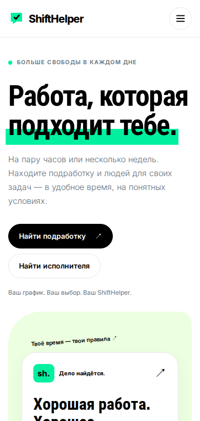
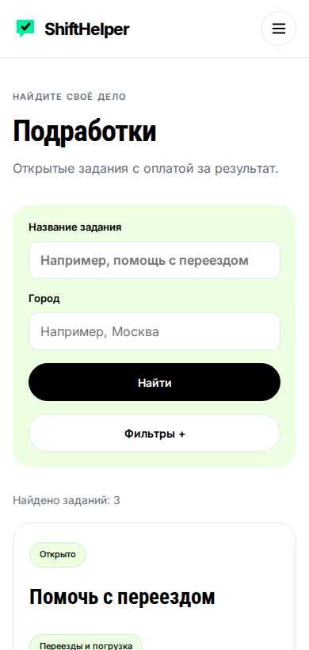
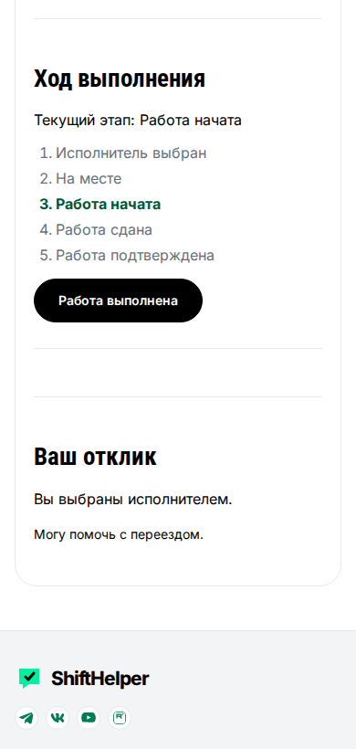

# ShiftHelper

**English** · [Русский](README.ru.md)

[](https://github.com/sklyar-vlad/ShiftHelper/actions/workflows/ci.yml)

A platform for short-term gigs. Customers post jobs and choose a worker. Workers find gigs, mark their progress, and submit the finished work.

[](https://skillicons.dev/)

<p>
  
  
  
</p>

<!-- Room for GIFs showing a job posted with a map pin and progress updates on both sides. -->

## Getting started

You'll need Git, Docker Compose, and [Task v3](https://taskfile.dev/docs/installation). On Windows, run the commands in WSL with Docker Desktop integration enabled.

```sh
git clone --branch dev https://github.com/sklyar-vlad/ShiftHelper.git
cd ShiftHelper
task up
```

Open [ShiftHelper](http://shifthelper.localhost/) and sign up as a customer or worker.

## Development

React, TypeScript, and Vite on the frontend. Go, Gin, PostgreSQL, and Redis on the backend.

- [Frontend setup](frontend/README.md)
- [Local Swagger UI](http://shifthelper.localhost/docs/swagger.html) and [API contract](docs/openapi.yaml)
- [Environment, maps, and checks](docs/agents/development.md)
- [Project commands](Taskfile.yml) and [team guidelines](AGENTS.md)
