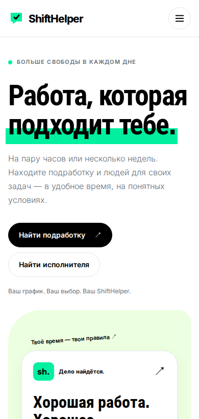
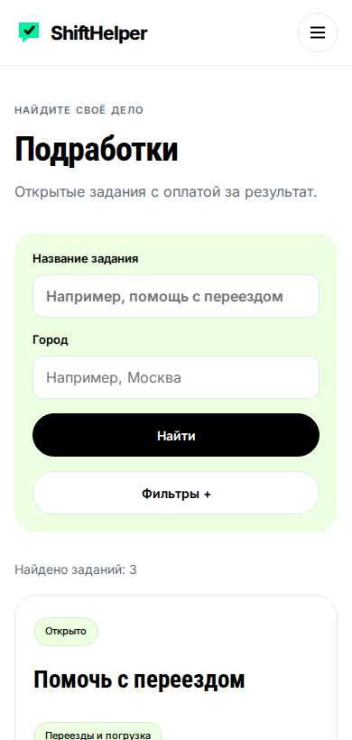
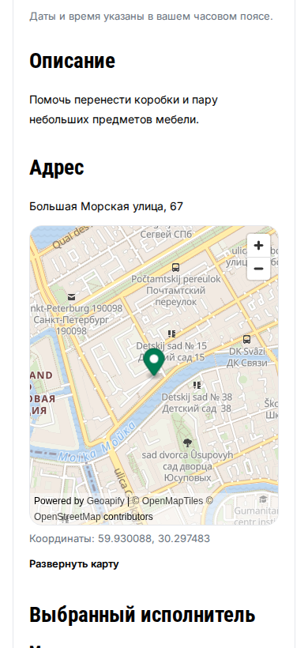

# ShiftHelper

[English](README.md) · **Русский**

Сервис краткосрочных подработок. Заказчик публикует задание и выбирает исполнителя. Исполнитель находит работу, отмечает этапы и сдаёт результат.

[](https://skillicons.dev/)

<p>
  
  
  
</p>

<!-- Место для GIF: публикация задания с точкой на карте и смена этапов в карточках обеих сторон. -->

## Запуск

Понадобятся Git, Docker Compose и [Task v3](https://taskfile.dev/docs/installation). На Windows запускайте команды в WSL с интеграцией Docker Desktop.

```sh
git clone --branch dev https://github.com/sklyar-vlad/ShiftHelper.git
cd ShiftHelper
task up
```

После запуска откройте [ShiftHelper](http://shifthelper.localhost/) и зарегистрируйтесь как заказчик или исполнитель.

## Разработка

React, TypeScript и Vite на фронтенде. Go, Gin, PostgreSQL и Redis на сервере.

- [Запуск frontend](frontend/README.md)
- [Swagger на локальном стенде](http://shifthelper.localhost/docs/swagger.html) и [контракт API](docs/openapi.yaml)
- [Настройка окружения, карты и проверки](docs/agents/development.md)
- [Команды проекта](Taskfile.yml) и [правила работы](AGENTS.md)

[](https://github.com/sklyar-vlad/ShiftHelper/actions/workflows/ci.yml)
